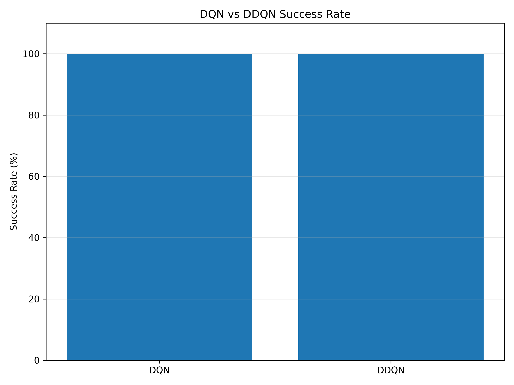
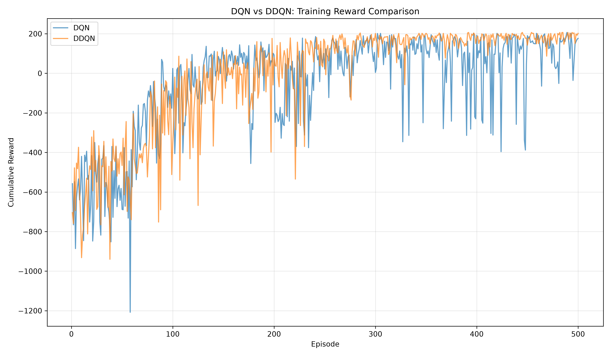
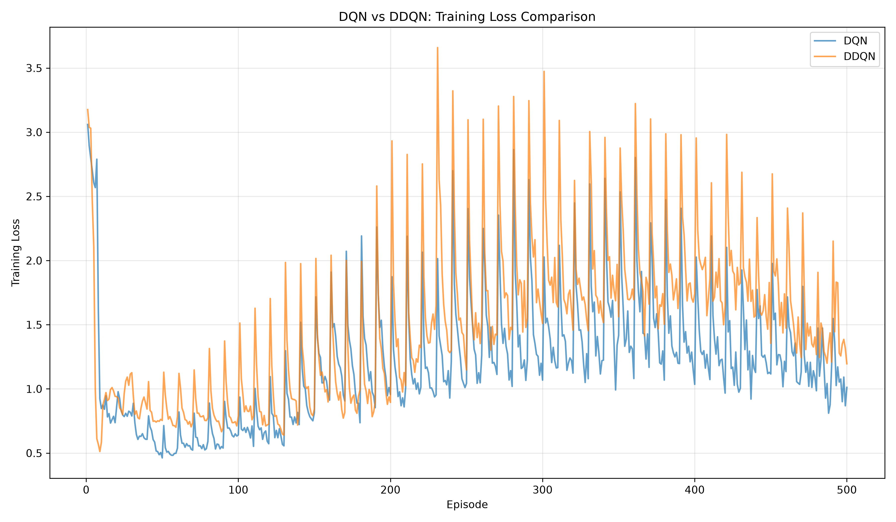
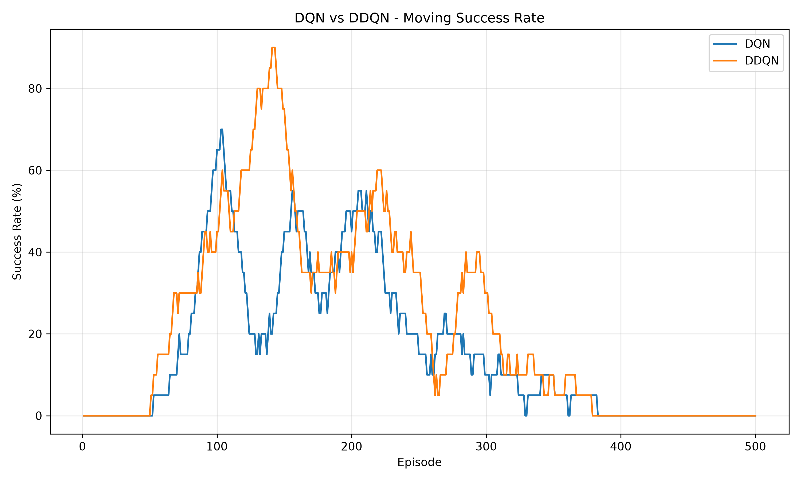
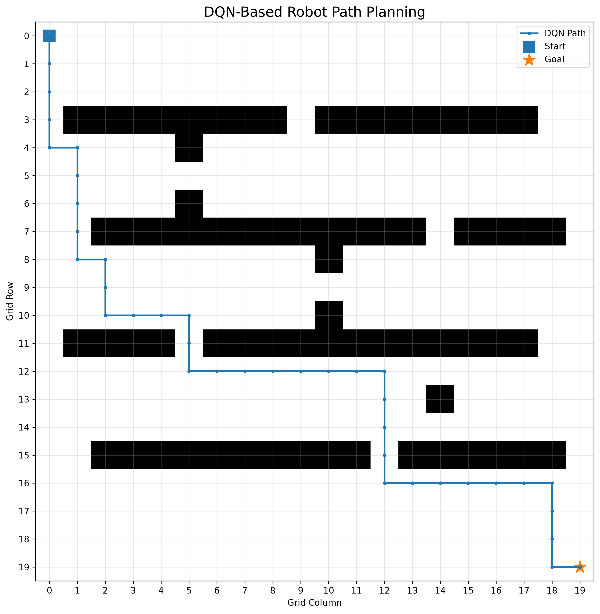

# 🤖 DRL Robot Path Planning using DQN & DDQN

<p align="center">

  **An Intelligent Robot Navigation System Powered by Deep Reinforcement Learning**

  <br/>

  
  
  
  
  

</p>

---

## 📌 Project Overview

**DRL Robot Path Planning** is an intelligent autonomous navigation system that uses Deep Reinforcement Learning (DRL) to enable a robot to learn optimal paths in a grid-based environment while avoiding obstacles.

The project implements and compares two reinforcement learning algorithms:

- **Deep Q-Network (DQN)**
- **Double Deep Q-Network (DDQN)**

The robot learns through interaction with its environment by receiving rewards and penalties for its actions. Through repeated training episodes, it learns to navigate from a starting position to a target destination while minimizing unnecessary movements and avoiding obstacles.

The system also includes random obstacle environments, curriculum-based training experiments, model evaluation, performance comparison, and interactive robot simulation.

## 🎯 Project Objectives

- Develop an intelligent robot navigation system using Deep Reinforcement Learning.
- Implement DQN and DDQN algorithms for autonomous path planning.
- Enable obstacle avoidance in grid-based environments.
- Compare the learning performance of DQN and DDQN.
- Experiment with random obstacle configurations and curriculum-based training.
- Evaluate trained models using performance metrics.
- Visualize robot navigation paths and training progress.
- Provide an interactive interface for robot path simulation.

## ✨ Key Features

| Feature | Description |
|---|---|
| 🤖 Autonomous Navigation | Robot learns to navigate independently |
| 🧠 DQN Algorithm | Deep Q-Network-based path planning |
| ⚡ DDQN Algorithm | Double Deep Q-Network implementation |
| 🚧 Obstacle Avoidance | Learns to avoid blocked grid cells |
| 🎲 Random Environments | Experiments with different obstacle configurations |
| 📈 Curriculum Learning | Training with progressively varied environments |
| 🔍 Model Comparison | Evaluates DQN and DDQN performance |
| 📊 Performance Analytics | Training rewards, losses and success analysis |
| 🗺️ Path Visualization | Displays learned robot navigation paths |
| 🎮 Interactive Simulation | Supports live and manual robot simulation |

## 🏗️ System Architecture

The project follows a Deep Reinforcement Learning-based architecture.

```text
             ┌──────────────────────┐
             │   Grid Environment   │
             │  Start / Goal /      │
             │     Obstacles        │
             └──────────┬───────────┘
                        │
                        ▼
             ┌──────────────────────┐
             │    State Input      │
             │   405-Dimensional   │
             └──────────┬───────────┘
                        │
                        ▼
             ┌──────────────────────┐
             │   Neural Network     │
             │  405 → 256 → 128    │
             │      → 64 → 4       │
             └──────────┬───────────┘
                        │
                        ▼
             ┌──────────────────────┐
             │   DQN / DDQN Agent   │
             │  Action Selection    │
             └──────────┬───────────┘
                        │
                        ▼
             ┌──────────────────────┐
             │  Robot Environment   │
             │  Movement & Rewards  │
             └──────────┬───────────┘
                        │
                        ▼
             ┌──────────────────────┐
             │ Experience Replay &  │
             │ Model Optimization   │
             └──────────┬───────────┘
                        │
                        ▼
             ┌──────────────────────┐
             │ Trained Navigation   │
             │      Policy          │
             └──────────────────────┘
```

## 🧠 Algorithms Implemented

### 1. Deep Q-Network (DQN)

DQN combines Q-learning with deep neural networks to estimate the expected future reward of available actions.

Key components:

- Neural network-based Q-value estimation.
- Experience Replay Memory.
- Epsilon-Greedy exploration.
- Target Network.
- Reward-based learning.

### 2. Double Deep Q-Network (DDQN)

DDQN improves upon traditional DQN by separating action selection and action evaluation to reduce Q-value overestimation.

Key components:

- Online Network for action selection.
- Target Network for action evaluation.
- Experience Replay.
- Epsilon-Greedy exploration.
- Improved Q-value estimation.

### 3. Random Obstacle and Curriculum Training

Additional experiments extend the learning environment with randomized obstacle configurations and curriculum-based training.

These experiments help evaluate how agents behave when the navigation environment changes.

## ⚙️ Environment Configuration

The project uses a grid-based robot navigation environment.

| Parameter | Configuration |
|---|---|
| Grid Size | 20 × 20 |
| Start Position | (0, 0) |
| Goal Position | (19, 19) |
| Number of Obstacles | 69 |
| State Dimension | 405 |
| Action Space | Discrete (4) |
| Manhattan Distance | 38 |
| Environment | Custom Grid-Based Environment |

The robot must learn to reach the goal while avoiding obstacle cells.

## 🏛️ Neural Network Architecture

The implemented DQN network uses the following architecture:

```text
Input Layer:       405 Neurons
       │
       ▼
Hidden Layer 1:   256 Neurons
       │
       ▼
Hidden Layer 2:   128 Neurons
       │
       ▼
Hidden Layer 3:    64 Neurons
       │
       ▼
Output Layer:       4 Neurons
```

**Total trainable parameters:** 145,348

The network estimates Q-values for the available actions.

## 🔬 Training Configuration

| Parameter | Value |
|---|---:|
| Training Episodes | 500 |
| Maximum Steps | 150 |
| Replay Buffer Capacity | 1,000 |
| Batch Size | 64 |
| Target Network Update | 10 |
| Optimizer | Adam |
| Loss Function | Smooth L1 Loss |
| Framework | PyTorch |

## 📊 Model Evaluation & Results

The project includes experiments for evaluating DQN and DDQN under different training configurations.

### Evaluation Categories

- DQN vs DDQN comparison.
- Random-environment DQN vs DDQN comparison.
- Training reward analysis.
- Training loss analysis.
- Episode length analysis.
- Exploration rate analysis.
- Test performance evaluation.
- Generalization experiments.
- Final robot path visualization.

### 📈 Performance Visualizations

**DQN vs DDQN Comparison**



**Training Reward Comparison**



**Training Loss Comparison**



**Random Environment Comparison**



**Robot Navigation Path**



*Note: Detailed experimental values are available in the CSV files inside the results directory.*

## 🛠️ Technologies Used

| Technology | Purpose |
|---|---|
| Python | Core programming language |
| PyTorch | Deep learning and neural networks |
| NumPy | Numerical computations |
| Pandas | Data processing and analysis |
| Matplotlib | Training and path visualization |
| Gymnasium | Reinforcement learning environment interface |
| Streamlit | Interactive application interface |

## 📂 Project Structure

```text
DRL_Robot_Path_Planning/
│
├── backend/
│   ├── dqn_agent.py
│   ├── ddqn_agent.py
│   ├── neural_network.py
│   ├── replay_memory.py
│   ├── environment.py
│   ├── train.py
│   ├── train_ddqn.py
│   ├── train_random_dqn.py
│   ├── train_random_ddqn.py
│   ├── compare_models.py
│   ├── compare_random_models.py
│   ├── live_simulation.py
│   ├── manual_simulation.py
│   └── ...
│
├── frontend/
│   ├── app.py
│   └── manual_simulator.py
│
├── models/
│   ├── dqn_model.pth
│   ├── dqn_best_model.pth
│   ├── ddqn_model.pth
│   ├── ddqn_best_model.pth
│   └── ...
│
├── results/
│   ├── comparison/
│   ├── csv/
│   ├── graphs/
│   └── paths/
│
├── visualization/
│   ├── plot_training_results.py
│   └── plot_ddqn_results.py
│
├── test_setup.py
├── .gitignore
└── README.md
```

## 🚀 Installation & Setup

### 1. Clone the Repository

```bash
git clone https://github.com/Princy33/DRL-Robot-Path-Planning.git
```

### 2. Navigate to the Project Directory

```bash
cd DRL-Robot-Path-Planning
```

### 3. Create a Virtual Environment

```bash
python -m venv venv
```

### 4. Activate the Virtual Environment

**Windows:**

```bash
venv\Scripts\activate
```

### 5. Install Dependencies

```bash
pip install torch numpy pandas matplotlib gymnasium streamlit
```

If additional dependencies are required by the application, install them according to the import requirements of the corresponding Python files.

## ▶️ Running the Project

### Launch the Interactive Application

```bash
streamlit run frontend/app.py
```

### Run DQN Training

```bash
python backend/train.py
```

### Run DDQN Training

```bash
python backend/train_ddqn.py
```

### Run Random Environment DQN Training

```bash
python backend/train_random_dqn.py
```

### Run Random Environment DDQN Training

```bash
python backend/train_random_ddqn.py
```

### Compare DQN and DDQN

```bash
python backend/compare_models.py
```

*Run commands from the project root directory. The repository also contains additional testing, simulation, and visualization scripts.*

## 📈 Applications

- Autonomous mobile robot navigation.
- Intelligent path planning.
- Obstacle avoidance systems.
- Reinforcement learning research.
- Robotics simulation.
- Smart navigation systems.
- AI-based decision-making applications.

## 🔮 Future Enhancements

- Extend the system to larger and more complex environments.
- Introduce real-time dynamic obstacle detection.
- Implement advanced algorithms such as PPO and A3C.
- Explore multi-agent reinforcement learning.
- Integrate robotic sensor data.
- Test navigation policies in real-world robotic environments.
- Improve generalization across unseen environments.

## 👩‍💻 Author

**Princy Mishra**

GitHub: [@Princy33](https://github.com/Princy33)

Project Repository: [DRL Robot Path Planning](https://github.com/Princy33/DRL-Robot-Path-Planning)

---

<p align="center">

  **🤖 Intelligent Navigation | 🧠 Deep Reinforcement Learning | 🚀 Autonomous Robotics**

  *Built with Python, PyTorch and Deep Reinforcement Learning.*

</p>
